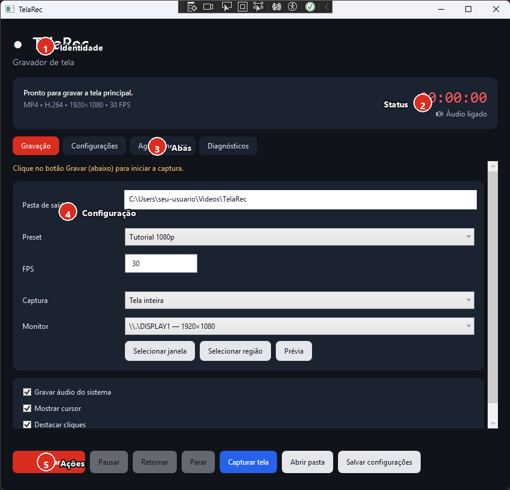
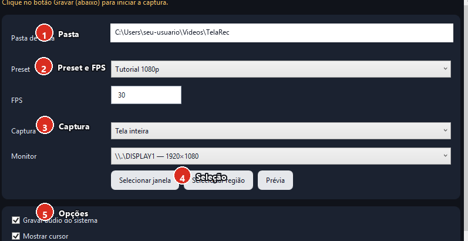
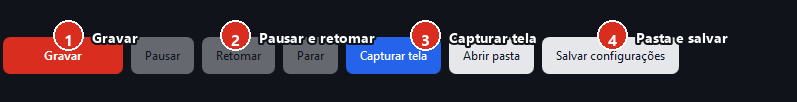

# TelaRec

Gravador de tela Windows x64 feito em C#/.NET 10 e WPF, com interface em português-BR. A solution separa interface MVVM, Core, integrações Windows e testes.

## Autor

**Gelson Ventura Gomes** — [@gventurasistemas](https://github.com/gventurasistemas)

## Capturas de tela

| Visão geral | Configuração |
| --- | --- |
|  |  |



## Licença e contribuições

O TelaRec é distribuído gratuitamente sob a [Licença MIT](LICENSE). Você pode usar, estudar, modificar e redistribuir o código, inclusive em projetos comerciais, desde que mantenha o aviso de copyright e o texto da licença.

Contribuições devem ser enviadas por pull request. A branch `main` é protegida: não são permitidos pushes diretos, e alterações só entram após revisão e aprovação do mantenedor.

## Formatos e perfis

Cada gravação usa um `RecordingProfile`: contêiner, codec, bitrate, FPS e resolução. A tela é redimensionada para a resolução do perfil antes de chegar ao encoder, preservando proporção e preenchendo as barras restantes em preto.

- **MP4 / H.264 ou HEVC:** gerado nativamente por Media Foundation quando o codec estiver disponível no Windows.
- **MKV e MOV:** gravam primeiro o MP4 temporário nativo e o backend `FfmpegRecordingExporter` faz a conversão isolada para H.264 ou HEVC.
- **GIF:** é gerado somente a partir de um vídeo existente, escolhido no seletor ou arrastado para **Converter para GIF**. A conversão usa `palettegen` e `paletteuse`, é limitada a 30 FPS e só publica o resultado se ele respeitar o limite de tamanho configurado (25 MB por padrão).

MKV, MOV e GIF requerem `ffmpeg.exe`. Em cada publicação, o projeto copia a build local de `ffmpeg\bin\ffmpeg.exe` para `tools\ffmpeg.exe`, com a licença e os dados da build no mesmo diretório. A build Windows x64 usada pelo projeto é obtida em [gyan.dev/ffmpeg/builds](https://www.gyan.dev/ffmpeg/builds/); a versão e o commit de origem correspondentes estão em [THIRD-PARTY-NOTICES.md](THIRD-PARTY-NOTICES.md). O TelaRec verifica o executável, versão, encoders e filtros necessários **antes** de abrir a captura; sem capacidade compatível, informa a causa e sugere MP4 nativo sem criar sessão parcial. Para impedir ambiguidade, o TelaRec não usa `PATH` como fallback.

A conversão externa escreve primeiro um arquivo temporário no diretório de saída e só publica o destino após êxito. Se o FFmpeg falhar, o destino final não é criado e o MP4 intermediário é preservado com o sufixo `-intermediario-<sessão>.mp4` para recuperação manual.

## MVP

- Grava tela inteira, janela escolhida ou região em MP4/H.264.
- Inicia, pausa, retoma e para. Mostra a duração em tempo real.
- Grava áudio do sistema, do microfone ou dos dois em AAC estéreo 48 kHz. Se uma fonte de áudio falhar, o vídeo e a outra fonte continuam e a interface informa o problema.
- Salva na pasta configurável; cria um arquivo temporário no mesmo diretório e só o renomeia após a finalização bem-sucedida. Um arquivo existente nunca é sobrescrito silenciosamente.

## Alvos de captura e prévia

O modo **Tela inteira** permite escolher cada monitor disponível. **Janela selecionada** e **Região personalizada** usam o mesmo backend WGC/D3D11 da gravação. O botão **Prévia** abre uma sessão WGC curta e independente antes de gravar; a própria janela de prévia pede exclusão da captura no Windows para não gerar efeito de espelho. O seletor de janela ignora o próprio TelaRec, janelas invisíveis ou minimizadas e carrega no máximo três miniaturas por vez fora da thread da interface. Cada miniatura tem limite de 2.048 px por lado e 2 milhões de pixels, com 350 ms por janela; atrasos ou falhas exibem um placeholder, sem impedir a seleção das demais.

A região é desenhada no monitor escolhido e pode ser ajustada pelos quatro cantos antes de confirmar. Regiões e o monitor escolhido são persistidos em `settings.json`, incluindo o índice do monitor para restauração em configurações de múltiplas telas. Janelas persistidas são revalidadas pelo handle ou por um título único ao abrir; se não existirem mais, o TelaRec volta com segurança à tela inteira. A seleção é validada novamente imediatamente antes da captura para rejeitar alvos fechados, ocultos, minimizados ou pertencentes ao próprio TelaRec.

## Apresentação

O compositor recebe o quadro de tela já redimensionado e aplica os overlays antes do encoder:

- Marca d’água de texto ou PNG, com posição, opacidade e escala.
- Webcam via DirectShow/OpenCV, com último quadro sincronizado pelo mesmo relógio monotônico da gravação, posição, opacidade e escala.

A webcam é opcional. Se o dispositivo não abrir ou parar, o TelaRec registra a falha e continua gravando a tela. O compositor está no Infrastructure; a WPF apenas persiste e envia as configurações.

## Cursor e efeitos de clique

O cursor é incluído por padrão. A opção **Mostrar cursor** (`ShowCursor`) decide se ele aparece no vídeo e a escolha é aplicada na próxima gravação, inclusive agendada, sem reiniciar o aplicativo.

Com **Destacar cliques** (`ShowClickEffects`) ativo, um hook global passivo `WH_MOUSE_LL` observa cliques apenas durante a gravação. Ele sempre chama `CallNextHookEx`, portanto nenhum clique do usuário é bloqueado ou engolido, e é desinstalado ao parar a gravação ou fechar o aplicativo. Cada clique é convertido das coordenadas físicas da tela para o quadro de saída considerando o recorte da região, o deslocamento de monitores secundários, o DPI por monitor e a escala do perfil. O compositor desenha um halo/ripple antes do encoder e remove o efeito quando ele expira, sem bloquear a thread de interface. Duração (0,6 s), raio (28 px) e cor (#FF3B30) têm padrões seguros persistidos em `settings.json`.

Os textos da WPF usam recursos em Resources/Strings.resx (pt-BR padrão) e Resources/Strings.en-US.resx. A cultura da interface segue a cultura de interface do Windows/.NET.

## Microfone e mixagem (P06)

Na seção **Áudio**, escolha **Sem áudio**, **Sistema**, **Microfone** ou **Sistema e microfone**. A lista de dispositivos usa WASAPI e permite selecionar um microfone específico; sem seleção, é usado o dispositivo padrão do Windows. Cada fonte tem ganho de 0 a 4 e mute independente, persistidos em `settings.json`.

`WasapiLoopbackAudioCaptureService` e `WasapiMicrophoneCaptureService` convertem PCM16/24/32 e float32 para PCM16, 48 kHz, estéreo. O downmix de 1 a 8 canais preserva L/R, centro, LFE e surrounds com ganhos conservadores. O mixer alinha a latência inicial dos dispositivos, mistura os blocos por timestamp, aplica saturação contra clipping e preenche uma fonte ausente com silêncio. A diferença máxima observada entre as fontes é registrada; acima de 100 ms, aparece também em Diagnósticos.

Desconectar ou perder o microfone durante a gravação não interrompe vídeo nem áudio do sistema. A medição de 30 minutos deve ainda ser repetida manualmente em cada combinação real de drivers e dispositivos antes de uma distribuição pública.

## Screenshots, presets e atalhos

**Capturar tela** (botão azul ou `Ctrl+Alt+S`) salva um PNG do monitor sob o cursor na pasta de saída. `ScreenshotService` também aceita `ScreenshotScope.AllMonitors` para gerar um arquivo por monitor, com sufixo numérico. O caminho é informado no status e nos diagnósticos.

O seletor de **Preset** aplica resolução, FPS, qualidade e bitrate de uma vez:

- **Tutorial 1080p:** 1920×1080, 30 FPS, qualidade alta.
- **Leve 720p:** 1280×720, 30 FPS, qualidade média.
- **Alta qualidade 60 FPS:** 1920×1080, 60 FPS, qualidade alta.

Ao editar manualmente resolução, FPS, qualidade ou bitrate, o preset muda para **Personalizado**. A escolha é persistida em `settings.json`. O nível de **Qualidade** (Alta/Média/Baixa) recalcula o bitrate sugerido por resolução e FPS; o campo de bitrate continua editável.

Os atalhos globais são configuráveis na aba Configurações e aplicados sem reiniciar o app:

- **Gravar/parar** (`Ctrl+Alt+R`): alterna entre iniciar e parar.
- **Pausar/retomar** (`Ctrl+Alt+P`): alterna entre pausar e retomar.
- **Capturar tela** (`Ctrl+Alt+S`): salva o PNG.

O parser em `TelaRec.Core.Input.HotkeyGesture` aceita combinações como `Ctrl+Alt+Shift+F9`. Se outro programa já usa a combinação, `RegisterHotKey` falha e o TelaRec mostra a mensagem de conflito no status e nos diagnósticos, mantendo o restante dos atalhos funcionando. O cabeçalho acompanha contêiner, codec, resolução e FPS selecionados (por exemplo, `MKV • H.264 • 1920×1080 • 30 FPS`).

## Interface, internacionalização e agendamento (P05)

Todos os textos visíveis da interface estão nos recursos `Resources/Strings.resx` (padrão pt-BR), `Resources/Strings.pt-BR.resx` e `Resources/Strings.en-US.resx`, com paridade de chaves verificada por `ResourceParityTests`. A cultura da interface segue a cultura de interface do Windows/.NET. Mensagens dinâmicas usam parâmetros (`string.Format`/`Strings.FormatText`).

A aba **Configurações** foi reorganizada em seções (Vídeo, Áudio, Sobreposições, Atalhos, Saída) dentro de `ScrollViewer`, com `ColumnDefinitions` reais, espaçamento consistente e largura mínima útil, mantendo o tema escuro. Campos inválidos são destacados e explicados via `INotifyDataErrorInfo`; a gravação não inicia e as configurações não são salvas enquanto houver erro. A pasta de saída é criada automaticamente ao salvar, quando possível.

A aba **Diagnósticos** lista os últimos 20 eventos (timestamp, severidade, código, mensagem), com cores por severidade e botão **Limpar**. A mesma informação continua sendo registrada no log de arquivo. A aba **Agendamentos** lista cada agendamento com início, fim, estado e motivo, assinando `RecordingScheduler.StatusChanged` na thread de interface. As transições são `Pendente → Iniciando → Gravando → Concluído`; cancelar usa `Pendente → Cancelado` ou `Iniciando/Gravando → Cancelando → Cancelado`. Se a parada falhar, o item volta a `Gravando` com erro e permanece cancelável.

O comportamento de fechamento é configurável em **Fechar minimiza para a bandeja** (padrão ativo). Ao fechar, a janela é ocultada e o TelaRec continua na bandeja; o menu de contexto oferece **Abrir TelaRec** e **Sair**. Notificações (balão) são exibidas ao iniciar, pausar, concluir ou falhar a gravação. Qualquer atalho global acionado com a janela oculta restaura e ativa a janela antes de executar o comando.

## Confiabilidade

Cada sessão cria um journal JSON em AppData/TelaRec/sessions antes de iniciar a captura. O journal contém o identificador da sessão, arquivo temporário, destino final e estado. Atualizações e conclusão são serializadas por sessão, portanto um update atrasado não recria um journal já concluído. A recuperação na abertura seguinte existe para encerramentos abruptos (queda do processo ou desligamento): remove somente escritas `.json.tmp` incompletas dentro da pasta privada do journal. Toda mídia registrada é preservada: o MP4 temporário vira `<nome>-recuperavel-<sessão>.mp4` e um temporário de exportação vira `<nome>-export-recuperavel-<sessão>.<extensão>`; caminhos externos ou inválidos permanecem intocados. Se o rename falhar, o arquivo e o journal ficam no caminho original para nova tentativa. Quando a finalização falha, o caminho recuperável é exibido no diagnóstico; mídia potencialmente válida nunca é apagada automaticamente.

O agendador impede períodos sobrepostos e confere se já existe uma gravação ativa. As regras são persistidas atomicamente em `%APPDATA%\TelaRec\schedules.json` e restauradas no próximo início; uma sessão que estava em `Starting`, `Recording` ou `Cancelling` é rearmada como `Pending`, evitando estado fantasma após uma queda. Regras são protegidas por uma única sincronização; o cancelamento de uma sessão ativa aguarda um início em curso, solicita `StopAsync` e só remove a regra após a parada. Tanto a gravação manual quanto a agendada verificam antes de iniciar se a captura de tela é suportada e se a sessão está desbloqueada; quando não está disponível, o motivo é exibido e o estado permanece Idle, sem registrar falha. Falhas de áudio ou webcam não param o vídeo. A interface mostra o diagnóstico mais recente na parte inferior da janela, com código, severidade e mensagem.

As configurações ficam em `%APPDATA%\TelaRec\settings.json`. A gravação é atômica: o conteúdo é escrito em um arquivo temporário no mesmo diretório, validado por desserialização e só então substitui o arquivo atual, mantendo `settings.json.bak` com a versão anterior. Se o JSON principal estiver corrompido, o TelaRec tenta o backup, registra um diagnóstico e, em último caso, abre com os valores padrão sem falhar. Antes de iniciar qualquer gravação, pasta de saída, FPS (1–120), bitrate (500 kb/s–80 Mb/s), resolução e combinação contêiner/codec são validados com mensagens específicas.

Logs de execução são gravados em `%LOCALAPPDATA%\TelaRec\logs` (um arquivo por dia, retenção de 14 dias). Exceções não tratadas são registradas e exibidas ao usuário, e o encerramento libera captura, áudio, webcam e encoder de forma assíncrona, sem deixar arquivos temporários.

## Pipeline

1. `WindowsGraphicsCaptureService` cria um `GraphicsCaptureItem` para monitor ou janela e usa `Direct3D11CaptureFramePool.CreateFreeThreaded`. Copia a textura D3D11 para memória gerenciada por meio de uma textura de staging e entrega quadros BGRA. Para região, recorta em coordenadas físicas do monitor. As dimensões H.264 são arredondadas para números pares. Quando uma janela muda de tamanho, o frame pool é recriado; a saída conserva o tamanho inicial e preenche as partes descobertas com preto.
2. A captura usa `SystemRelativeTime` da WGC, em relógio monotônico. Um temporizador repete o último quadro quando a tela não muda, preservando a duração de uma gravação estática.
3. `WasapiLoopbackAudioCaptureService` e `WasapiMicrophoneCaptureService` capturam as fontes WASAPI escolhidas. O reamostrador compartilhado normaliza PCM/float para PCM16, 48 kHz e dois canais, preservando a continuidade entre blocos. `TimestampedAudioMixer` compensa a latência inicial, aplica ganho/mute/clipping e entrega uma única linha de áudio ao encoder. A fila também preenche lacunas sem dados com silêncio.
4. `RecordingService` centraliza áudio e vídeo em um `Channel` FIFO limitado a 8 pacotes, com uma fila de reordenação igualmente limitada. Os seis primeiros slots podem receber vídeo; os dois restantes preservam margem para áudio. Há ainda orçamento de 64 MiB para pixels BGRA pendentes, incluindo o quadro em codificação. Sob pressão, o próximo vídeo é descartado antes de escalar ou compor; a ordem e os timestamps dos itens aceitos não mudam. Todo descarte de vídeo ou áudio é contado e registrado nos Diagnósticos e no log final.
5. `MediaFoundationVideoEncoderService` converte BGRA para NV12 usando buffer temporário alugado, devolvido ao pool somente após a cópia síncrona para o buffer nativo, e escreve H.264/HEVC e AAC com `IMFSinkWriter`. O throttling do Sink Writer é desabilitado para não atrasar a drenagem da fila após parar. Os timestamps e durações do Media Foundation usam unidades de 100 ns, iguais aos ticks de `TimeSpan`.
6. Após a finalização do MP4 temporário, `FfmpegRecordingExporter` produz MKV ou MOV quando o perfil pede esses formatos. GIF é uma conversão explícita de um vídeo existente.

## Decisão do encoder

O MVP usa **Media Foundation**, disponível no Windows, para H.264, AAC e MP4. FFmpeg é incluído somente para contêineres e codecs extras; sua licença e os dados da build acompanham o executável em `tools`. A conversão BGRA → NV12 é feita no processo; em resoluções e FPS elevados, o custo de CPU deve ser medido antes de definir presets mais exigentes.

## Performance e jogos (Fase 6)

Na abertura da interface, `MediaFoundationVideoEncoderCapabilitiesService` enumera os MFTs de vídeo registrados no Windows para H.264 e HEVC. Em **Configurações → Vídeo**, o modo **Automática** seleciona H.264 por GPU quando houver MFT de hardware; **Preferir GPU** registra o fallback quando não houver suporte; e **Somente software** desabilita explicitamente transforms de hardware. Se um driver anunciar H.264 por GPU mas recusar a configuração inicial, o writer é recriado em software antes do primeiro quadro ser gravado. O resumo de desempenho apresenta implementação ativa, frames descartados e tempo médio de codificação. HEVC só aparece como nova escolha quando um encoder HEVC nativo é detectado; se uma configuração HEVC já salva perder suporte após troca de driver, ela é preservada e o início é bloqueado com orientação para selecionar H.264. Nunca há troca silenciosa de codec.

Os contadores distinguem frames limitados pelo FPS de destino, frames repetidos em tela estática, drops de vídeo por pressão da fila e drops de áudio. A telemetria também informa profundidade/pico das filas, bytes BGRA pendentes (limite de 64 MiB), alocações gerenciadas da sessão, latência média de fila e tempo médio de encode. Ao concluir ou falhar, os números são emitidos como log estruturado e uma advertência é adicionada aos Diagnósticos para cada tipo de perda. A prévia é deliberadamente independente da gravação: ela mantém apenas o frame visual mais recente e agrupa os callbacks do Dispatcher, descartando frames visuais antigos sem competir com o encoder.

**Captura de jogos — decisão atual:** WGC/D3D11 continua sendo o backend padrão para tela, janela e jogos em janela, borderless ou fullscreen compositor. Ele compartilha o mesmo dispositivo D3D11, preserva DPI, cursor e a prévia já existente. `DXGI Desktop Duplication` é a alternativa para jogos em fullscreen exclusivo quando WGC não entrega quadros; ela não suporta captura direta de uma janela e exigiria uma implementação separada por output/adaptador, com tratamento de `DXGI_ERROR_ACCESS_LOST`, rotação, HDR e troca de GPU. Por isso não há fallback automático nesta versão: alternar automaticamente poderia capturar o monitor ou adaptador errado e gerar uma gravação vazia. A duplicação DXGI fica isolada como próximo backend de jogos, após uma matriz de dispositivos físicos.

Validação manual obrigatória antes de distribuir:

- H.264 1080p30 e 1080p60, nos modos Automática e Somente software, verificando o resumo e o arquivo MP4.
- HEVC somente quando a opção aparecer, confirmando reprodução em Filmes e TV/VLC e via `ffprobe`.
- Jogo em janela, borderless e fullscreen exclusivo, em cada GPU disponível (integrada e dedicada), verificando início, pausa, cursor e ausência de frames pretos.
- Dois monitores em adaptadores distintos, com captura em cada um; medir tempo de início e conferir que os frames descartados permanecem aceitáveis para o perfil selecionado.

## Estrutura

```text
src/TelaRec.App.Wpf          Views, ViewModels e shell Windows
src/TelaRec.Core             Contratos, alvos de captura e regras
src/TelaRec.Infrastructure   WGC/D3D11, WASAPI, Media Foundation e JSON
tests/TelaRec.Tests          Testes de regras e do serviço de gravação
tools/TelaRec.Smoke          Gravação curta de validação no desktop
```

Consulte também [arquitetura e pipeline](docs/arquitetura.md), [operação e suporte](docs/operacao.md) e os [ADRs](docs/adr). A implementação canônica da seleção de região fica em `src/TelaRec.App.Wpf/RegionOverlayWindow`; não há cópia ativa na raiz do repositório.

## Executar do código-fonte

Requer Windows 10 versão 2004 (build 19041) ou posterior, x64, .NET 10 SDK e sessão interativa de desktop. O `global.json` usa 10.0.100 como base e aceita faixas posteriores do SDK 10. A versão 2004 é necessária porque o `Direct3D11CaptureFramePool.CreateFreeThreaded`, usado pela captura WGC, só existe a partir dela. O aplicativo é configurado para `win-x64`; o SDK Windows 10.0.26100 instalado nesta máquina é usado para gerar as projeções WinRT, mantendo a versão mínima suportada em 19041.

```powershell
dotnet restore TelaRec.sln
dotnet test TelaRec.sln
dotnet run --project src/TelaRec.App.Wpf
```

Use o script de publicação abaixo para qualquer release; o comando `dotnet publish` isolado não é o fluxo oficial porque não gera manifesto, hash, validação de conteúdo nem prova de reprodutibilidade.

Na interface, escolha o monitor e o modo. Em **Janela selecionada**, clique em **Selecionar janela**; em **Região personalizada**, clique em **Selecionar região**, arraste o retângulo e ajuste os cantos se necessário. Use **Prévia** para verificar o alvo antes de gravar. A seleção visual fecha antes do início da captura.

Atalhos padrão: `Ctrl+Alt+R` inicia/para, `Ctrl+Alt+P` pausa/retoma e `Ctrl+Alt+S` captura a tela. Todos podem ser alterados na aba Configurações e passam a valer ao salvar.

## Distribuição portátil oficial

O pacote oficial é um ZIP `win-x64` **self-contained**: o computador de destino precisa de Windows 10 versão 2004 (build 19041) ou posterior, x64 e sessão gráfica, mas não precisa ter SDK ou runtime .NET instalado. O pacote não usa single-file nem trimming, pois WPF, WinRT/COM, Media Foundation e bibliotecas nativas carregam componentes dinamicamente. PDBs e arquivos de desenvolvimento são bloqueados pelo empacotador.

No repositório, execute um único comando em PowerShell:

```powershell
powershell.exe -NoProfile -ExecutionPolicy Bypass -File .\tools\Publish-Portable.ps1
```

Ele executa todos os testes, publica duas vezes com `PortableWinX64`, compara os manifestos SHA-256 para verificar reprodutibilidade, gera o ZIP com ordem/timestamp estáveis e valida o startup direto do `.exe` extraído com `DOTNET_ROOT` inválido. A saída fica em `artifacts\portable\TelaRec-<versão>-win-x64\` e contém o ZIP, `MANIFEST.sha256`, o hash do ZIP, `RELEASE.json` e logs de teste/publicação. O tamanho exato do pacote é exibido pelo script e deve ser registrado junto à release; ele varia com o runtime .NET e DLLs nativas do Windows.

O script limpa exclusivamente sua própria pasta versionada sob `artifacts\portable`; ele valida o caminho antes de qualquer remoção e nunca atua recursivamente na raiz do repositório. Os manifestos descrevem os arquivos extraídos; o hash ao lado do ZIP valida o pacote publicado. `LICENSE`, `THIRD-PARTY-NOTICES.md` e `tools\FFMPEG-LICENSE.txt` acompanham o ZIP. A publicação exige `ffmpeg\bin\ffmpeg.exe` na raiz do repositório e o copia para `tools\ffmpeg.exe`.

Checklist da máquina limpa: extraia o ZIP em um caminho com espaços sem privilégios administrativos; confirme que não há SDK/runtime .NET instalado; abra `TelaRec.App.Wpf.exe`; configure uma pasta de saída gravável; grave e reproduza um clipe H.264; feche e abra novamente. Repita para áudio e HEVC quando suportados pelo driver.

## Versão, compatibilidade e atualização

O TelaRec usa SemVer. Tags de CI devem ter o formato `MAJOR.MINOR.PATCH` (por exemplo, `1.2.0`); builds locais recebem `-dev.local`, e o pacote portátil usa também o hash curto do commit. A aba **Sobre**, o diagnóstico `release.identity`, o log de startup, as propriedades do executável e o nome do ZIP exibem a mesma versão informacional. `FileVersion` e `AssemblyVersion` permanecem numéricos por exigência do Windows.

| Fonte | Consumidores |
| --- | --- |
| `Directory.Build.props` | metadados Product/Company/Copyright e assemblies |
| tag CI ou hash Git local | `Version`, `InformationalVersion`, `RELEASE.json` e nome do ZIP |
| `ReleaseIdentity` | aba Sobre, log e diagnóstico sem caminhos ou dados pessoais |
| schemas persistidos | settings, seleção de presets, agendamentos e journal |

Documentos persistidos antigos são migrados de modo compatível; `settings.json` mantém backup antes da substituição. Um schema criado por versão mais nova é preservado, e o usuário deve restaurar o backup com uma versão compatível. O canal oficial continua sendo o ZIP portátil; a decisão sobre MSI, MSIX, instalador e atualização automática está registrada no [ADR de canal e atualização](docs/adr/0001-canal-portatil-e-atualizacao.md).

## Operação e contribuição

Os diretórios de dados, recovery de arquivos parciais, coleta segura de diagnósticos e o roteiro de release estão em [Operação e suporte](docs/operacao.md). As fronteiras App/Core/Infrastructure, o pipeline e suas responsabilidades estão em [Arquitetura](docs/arquitetura.md). A decisão de higiene de build, codec, recovery e CI está no [ADR 0002](docs/adr/0002-higiene-build-pipeline-e-recuperacao.md).

## Validação manual

```powershell
dotnet run --project tools/TelaRec.Smoke -- C:\Temp\telarec-region.mp4 --integration --audio --region
dotnet run --project tools/TelaRec.Smoke -- C:\Temp\telarec-display.mp4 --integration --display --short
dotnet run --project tools/TelaRec.Smoke -- C:\Temp\telarec-clicks.mp4 --integration --region --click-effects --cursor-off
dotnet run --project tools/TelaRec.Smoke -- C:\Temp\telarec-hevc.mp4 --integration --codec Hevc --short
dotnet run --project tools/TelaRec.Smoke -- C:\Temp\telarec-30min.mp4 --integration --region --audio --microphone --duration-seconds 1800 --timeout-seconds 1860
```

O smoke rápido é apenas o build e os testes da solução; a gravação de mídia é deliberadamente opt-in com `--integration`. Ela exige uma sessão gráfica Windows interativa e cria uma janela visual animada determinística, além de tocar um sinal baixo de 440 Hz quando `--audio` está presente. Por segurança, o modo padrão é `--region`: a própria janela do processo não pode ser alvo de WGC. `--display` permite validar o monitor; a validação manual de uma janela externa deve ser feita pelo aplicativo TelaRec. `--silent` testa a geração de AAC durante silêncio. `--region` usa uma área de 641×481 pixels e confirma a saída no perfil 640×480. `--codec Hevc` retorna `SKIP` quando o Windows não oferece esse encoder; H.264 é obrigatório. O smoke abre e decodifica o MP4 com Media Foundation, validando caixa `ftyp`, codec, dimensão, FPS efetivo (60% a 125% da meta), duração, frames não pretos, áudio e deriva A/V quando solicitados. `0` significa sucesso, `1` falha de mídia, `2` `SKIP` explícito e `3` timeout. Em qualquer falha, o MP4, `.smoke.log` e `.smoke.json` são preservados. Use `--duration-seconds` para gravações longas e `--timeout-seconds` para o limite global; sem timeout explícito, o limite é a duração mais 30 segundos, com mínimo de 30 segundos. Os testes unitários cobrem reinício, pausa, retomada, finalização, falhas de áudio/encoder, projeção de cliques, expiração do efeito, parser de atalhos, mapeamento de qualidade para bitrate, presets, alternância por atalho e screenshot. A validação manual desta versão confirmou PNG gerado por `Ctrl+Alt+S`, gravação iniciada/parada por `Ctrl+Alt+R`, pausa/retomada por `Ctrl+Alt+P`, atalho personalizado persistido após reinício e aviso de conflito quando outro processo já detém a combinação.

Em 13/11/2026, tela inteira, região e janela geraram MP4s decodificáveis com PyAV/FFmpeg nesta máquina. Também foram validados GIF, MKV e MOV: GIF 640×480, MKV/H.264 640×480 e MOV/H.264 640×480 pelo FFprobe. No teste com sinal, os últimos quadros decodificados de vídeo e áudio ficaram separados por cerca de 53 ms. Esses testes usam o desktop e o dispositivo de saída desta máquina; vale repetir em outros monitores, dispositivos de áudio e drivers gráficos.

## Limites atuais

- Uma região que cruza monitores é limitada ao monitor com maior interseção; para capturar outro monitor, escolha-o antes de selecionar a região.
- A sincronização de áudio depende dos relógios e drivers WASAPI; valide gravações longas em cada combinação de dispositivos antes de liberar uma versão pública.
- A sobreposição de seleção visual abre no monitor do aplicativo; a gravação de um alvo selecionado usa coordenadas físicas e o manifesto do aplicativo declara DPI por monitor.
